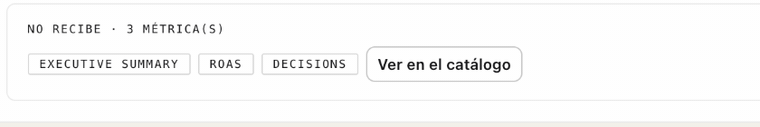
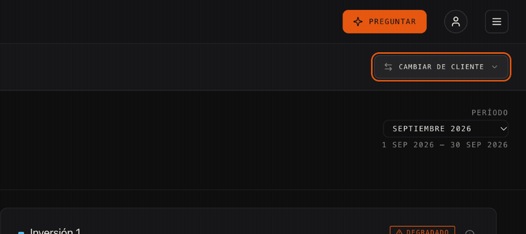
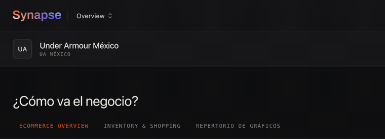
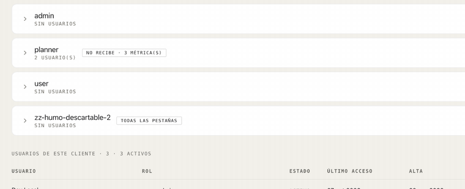
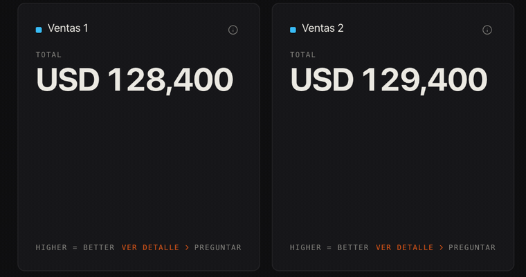

# Microinteracciones · decisión · 2026-10-27

> **Cierra `docs/PROPUESTA-2026-10-20-microinteracciones.md`**, que no se
> edita. Lo de abajo es lo que se decidió, cómo quedó construido y qué tiene que
> mirar diseño.

## Qué se decidió

**Decisión humana del 2026-10-27**, sobre las tres preguntas de la propuesta:

| Pregunta | Respuesta |
|---|---|
| ¿Duraciones de 120 a 200 ms? | **Sí** · 120 ms para lo que responde al puntero, 180 ms para lo que aparece |
| ¿El dato nunca se anima? | **Correcto** · ni cifras que cuentan ni trazos que se dibujan. El dato aparece entero, con un fundido de opacidad |
| ¿Los esqueletos siguen sin pulso? | **Sí** · se mantiene la decisión de `SkeletonRows.tsx` y `LoadingState.tsx` |

Y el humano pidió verlo construido y grabado, en una rama, antes de mergear.

## Cómo quedó construido

**Los tokens** van en `src/tokens/decisiones.css`, como `--color-peligro`: escritos
a mano hasta que el `.pen` los declare.

| Token | Valor | Utilidad |
|---|---|---|
| `--transition-duration-rapida` | 120 ms | `duration-rapida` |
| `--transition-duration-base` | 180 ms | `duration-base` |
| `--ease-salida` | `cubic-bezier(0.2, 0, 0, 1)` | `ease-salida` |

**Los nombres no son los de la propuesta** (`--duracion-rapida`): Tailwind arma
`duration-*` desde `--transition-duration-*` y `ease-*` desde `--ease-*`. Con
otro nombre, la utilidad no existe.

**`design-lint` suma la regla `movimiento`**: prohíbe cualquier otra duración o
curva, `transition-all`, una lista de propiedades que no sea de `opacity` o de
`transform` y `animate-*`. Verificada rompiéndola: marca las seis formas y deja
pasar las válidas.

**Con menos movimiento pedido en el sistema, nada se mueve**: un solo bloque de
`prefers-reduced-motion` en `decisiones.css` lleva toda transición a cero. Va en
un lugar y no clase por clase, para que una transición olvidada no siga
animando.

**Lo que aparece usa `starting:`**, que es una transición y no una animación:
corre sólo cuando el elemento se monta. Por eso un dato que se refresca sin pasar
por la carga no parpadea.

## Las grabaciones · en cámara lenta ×10

**Todas van diez veces más lentas que en el producto**: con 120 y 180 ms, una
captura cuadro a cuadro no alcanza a ver el movimiento. Para grabar se inyectó en
la página una regla que lleva las duraciones a 1,2 s y 1,8 s; el código queda con
los valores de arriba. Cada GIF sostiene el antes y el después.

### 1 · El hover responde, no salta

Botones, opciones, cards de clientes, el navbar y los disparadores de menú.

### 2 · El menú aparece desde el disparador

Fundido y 4 px de desplazamiento. **Se cierra sin animación**: quien cierra ya
decidió. Vale para el selector de clientes, el ≡, el del usuario y el de la
consola.

### 3 · Al cambiar de cliente, el nombre vuelve a entrar

Es el que más vale: en seco, el cambio de cliente se podía no notar.

### 4 · Lo que se pliega

El chevron gira y el detalle entra con un fundido. **La altura cambia en seco**:
animarla movería todo lo que está debajo.

### 5 · La llegada del dato

Al cambiar de período, el panel pasa por su esqueleto —quieto, sin pulso— y el
cuerpo entra con un fundido de opacidad. **El título y el pie no se mueven**, y la
cifra aparece ya con su valor.

**Las cifras son del modo mock**, a propósito: el repositorio es público y una
grabación contra el backend local mostraba las de un cliente. La 1 y la 4 se
grabaron contra el backend local porque administración no se recorre en el mock,
y no muestran cifras: un botón y los roles de prueba.

## Qué tiene que mirar diseño

1. **Las dos duraciones y la curva.** ¿Se declaran en el `.pen` así, o se cambian?
   Si cambian, es una línea en `decisiones.css`.
2. **Los 4 px del menú.** Es lo único que se desplaza en todo el producto.
3. **El fundido de llegada.** ¿180 ms se siente como respuesta o como espera?
4. **Lo que quedó afuera a propósito**, en §6 de la propuesta: cifras que
   cuentan, gráficos que se dibujan, la grilla, alturas animadas, el naranja en
   movimiento y celebraciones.
